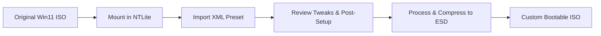

# ⚡ Windows 11 26H2 Pro Custom & Debloat NTLite Presets

[-0078D6?style=for-the-badge&logo=windows&logoColor=white>)](https://www.microsoft.com/software-download/windows11)
[](https://www.ntlite.com/)
[](LICENSE)
[](https://github.com/)

A collection of battle-tested, modular **NTLite XML presets** specifically engineered for **Windows 11 (26H2 / 25H2)**. Designed to strip invasive telemetry, remove OEM/consumer bloatware, lower background resource utilization, and tune low-level system latency—while strictly maintaining enterprise-grade stability, developer tooling, and essential Windows subsystem components.

---

- 📑 Table of Contents
- [Overview](#-overview)
- [Available Presets](#-available-presets)
- [Key Features &amp; Optimizations](#-key-features--optimizations)
- [Prerequisites](#-prerequisites)
- [Step-by-Step Guide](#-step-by-step-guide)
- [Automated Post-Setup Script](#-automated-post-setup-script)
- [Verification &amp; Testing](#-verification--testing)
- [Disclaimer &amp; Safety](#-disclaimer--safety)
- [Vietnamese Quick Guide](#-t%E1%BB%95ng-quan-ti%E1%BA%BFng-vi%E1%BB%87t)

---

## 🎯 Overview

Default Windows 11 installations ship with telemetry daemons, background diagnostic logging, cloud search telemetry, and bundled third-party applications that consume valuable CPU cycles, memory, and disk I/O.

These presets provide a **clean, lightweight, reproducible base image** that:

- De-bloats Windows without breaking critical APIs (e.g., preserving **Edge WebView2**, **Microsoft Store**, and **Win32 subsystem integrity**).
- Drastically reduces ISO size via high-ratio **ESD compression**.
- Speeds up OS deployment through streamlined unattended installation.

---

## 📦 Available Presets

| Preset File                                                       | Target Audience                                                  | Key Highlights                                                                                                                                                                                                                                                                                                                                                                                                                                                                                                                                                                                                                                                                                                                                                                                                                                                                                          |
| :---------------------------------------------------------------- | :--------------------------------------------------------------- | :------------------------------------------------------------------------------------------------------------------------------------------------------------------------------------------------------------------------------------------------------------------------------------------------------------------------------------------------------------------------------------------------------------------------------------------------------------------------------------------------------------------------------------------------------------------------------------------------------------------------------------------------------------------------------------------------------------------------------------------------------------------------------------------------------------------------------------------------------------------------------------------------------ |
| **`Win11_Pro_25H2_IT_Dev_Edition.xml`** `(Recommended)` | **Software Engineers, DevOps, IT Sysadmins & Power Users** | • **Full Virtualization Stack:** Out-of-the-box support for `WSL2`, `Hyper-V`, `Containers`, `VirtualMachinePlatform`, and `Windows Sandbox`.• **Developer Ecosystem:** Keeps `Microsoft Store` & `winget` intact; enables `DeveloperMode` and `LongPathsEnabled` (>260 chars for deep `node_modules`).• **Compiler & Build Optimization:** Pre-configured Windows Defender exclusions on common build directories (`C:\Projects`, `C:\Dev`, `D:\Projects`, `source`) to avoid build stalls.• **SSH & Network Operations:** Auto-starts `ssh-agent` service for Git SSH key management; keeps `OpenSSH`, `ReFS / Dev Drive`, `PktMon`, and `WinRM`.• **Memory & Disk Optimization:** Disables `SysMain`, groups `SvcHost` processes, and disables `hiberfil.sys` to instantly reclaim 4GB–16GB storage on drive `C:`. |
| **`Win11_Pro_25H2_Clean_Debloat.xml`**                    | **General Productivity, Office & Daily Use**               | • **Pure Debloat:** Completely strips Cortana, Bing News, Weather, Clipchamp, Xbox background tracking, and telemetry services.• **Privacy First:** Disables CEIP, diagnostic telemetry, Activity Feed history, and consumer advertising IDs.• **Responsive UI:** Instant context menu response (`MenuShowDelay = 0`), dark mode enforced, redundant window animations turned off.• **Typing & Locale:** Pre-configured with US English and standard Vietnamese Telex UTF-8 layout.                                                                                                                                                                                                                                                                                                                                                                                       |

---

## ✨ Key Features & Optimizations

### 🛡️ Privacy & Telemetry Hardening

- Disabled Windows Error Reporting (WER) and Diagnostic Telemetry (`diagtrack`, CEIP/SQM).
- Removed online Bing search integration from the Start menu (instant local-only search).
- Suppressed diagnostic data collection, advertising ID tracking, and telemetry feedback prompts.
- Blocked automated background installation of sponsored third-party UWP apps.

### ⚡ System Responsiveness & Low-Level Tweaks

- **Zero-Delay Menus:** Set `MenuShowDelay` to `0` for instantaneous right-click and flyout menus.
- **Visual Polish:** Preserved ClearType font edge smoothing (`Smooth edges of screen fonts`) and desktop icon drop shadows to guarantee visual clarity while disabling resource-draining window minimize/maximize animation delays.
- **Storage Reclaim:** Disabled Hibernation (`powercfg -h off`) to instantly free up gigabytes of disk space equal to physical RAM capacity.
- **File Explorer Polish:** Shows hidden files and file extensions (`.exe`, `.ps1`, `.txt`) by default.

### 💻 Developer-Centric Enhancements (IT Dev Edition)

- Pre-enabled `ssh-agent` Windows service running automatically.
- Antivirus scanning exclusions added to paths like `C:\Projects` and `C:\Dev` to dramatically increase compilation speeds for Rust, Go, C++, Node.js, and Java projects.
- Support for paths exceeding the 260-character Win32 limit (`LongPathsEnabled = 1`).

---

## 🛠️ Prerequisites

Before building your custom ISO, ensure you have:

1. **[NTLite](https://www.ntlite.com/download/):** Latest stable version (Free or Licensed).
2. **Official Windows 11 ISO:** Clean ISO image directly from [Microsoft](https://www.microsoft.com/software-download/windows11) or [UUP dump](https://uupdump.net/) (Windows 11 26H2 / 25H2 / 24H2, Pro 64-bit recommended).
3. **Storage:** At least 25GB – 35GB of free SSD space for temporary mount and capture directories.
4. **USB Drive:** Minimum 8GB for flashing with [Rufus](https://rufus.ie/) or [Ventoy](https://www.ventoy.net/).

---

## 🚀 Step-by-Step Guide



### 1. Mount the Base ISO

1. Open **NTLite**.
2. Click **Add** (top left) $\rightarrow$ **Image file (ISO, WIM, ESD)** $\rightarrow$ Select your official Windows 11 ISO.
3. Expand the image tree, right-click **Windows 11 Pro**, and select **Load**.
4. Allow NTLite a few minutes to mount the image to the temporary scratch directory.

### 2. Import and Apply the XML Preset

1. In the top toolbar, click **Preset** $\rightarrow$ **Import**.
2. Browse to this repository folder and select either:
   - `Win11_Pro_25H2_IT_Dev_Edition.xml`
   - `Win11_Pro_25H2_Clean_Debloat.xml`
3. Right-click the newly imported preset in the list and click **Load**.
4. NTLite will automatically check/uncheck all target components, services, scheduled tasks, and registry tweaks.

### 3. Configure Post-Setup Tasks (Optional)

If you wish to automatically deploy your essential software stack post-install:

1. Navigate to **Integrate** $\rightarrow$ **Post-Setup**.
2. Under **Post-logon (User)**, click **Add** $\rightarrow$ **File** and select `app_install.ps1`.
3. Set the mode to **Image** (embeds script directly into `C:\Windows\...`) and set parameters to:
   ```text
   -ExecutionPolicy Bypass -NoProfile
   ```

### 4. Build and Export the Optimized ISO

1. Navigate to the **Apply** section in the left sidebar.
2. Configure output options:
   - **Saving mode:** *Save the image and trim editions* (removes unused SKUs).
   - **Image format:** Select **ESD** (Solid high-compression, smallest file size) or **WIM**.
   - Check **Create ISO**.
   - Specify output path (e.g., `D:\ISOs\Win11_26H2_Pro_Optimized.iso`).
3. Click the green **Process** button in the upper ribbon.
4. The build process typically completes in 5 to 15 minutes depending on CPU speed and disk I/O.

---

## 📜 Automated Post-Setup Script (`app_install.ps1`)

The included [`app_install.ps1`](app_install.ps1) script provides reliable, silent software provisioning through the native Windows Package Manager (**winget**).

### Script Capabilities:

- **Connectivity Check:** Automatically pings `8.8.8.8` in an automated retry loop to verify network availability before attempting downloads.
- **Fail-Safe Iteration:** Packages are processed sequentially using an array loop—if any individual package encounters an issue, subsequent applications continue installing unhindered.
- **Pre-agreed Licenses:** Includes `--accept-source-agreements` and `--accept-package-agreements` to ensure truly unattended execution.

### Bundled Packages:

- **Developer Tools:** Visual Studio Code, VS Code Insiders, Git, Python 3.12, Node.js LTS, Google Antigravity IDE.
- **System Utilities:** 7-Zip, WinRAR, LocalSend, NTLite, UltraViewer.
- **Communication:** Zalo.

---

## 🔍 Verification & Testing

Always validate the generated image before flashing to bare-metal hardware:

- **Virtual Machines:** Test in **Hyper-V**, **VMware Workstation**, or **VirtualBox** with 4GB RAM to verify out-of-box setup (OOBE) and desktop logon.
- **Telemetry Verification:** Run Sysinternals **TCPView** or **Wireshark** to confirm the absence of background telemetry chatter.
- **Feature Check:** Verify Windows Update, Microsoft Store, and Terminal function properly.

---

## ⚠️ Disclaimer & Safety

- **No Piracy:** This repository provides **pure configuration blueprints (XML/PS1)**. It does not distribute ISO binaries, copyrighted binary blobs, activation scripts, or product keys.
- **Licensing:** Users are responsible for complying with Microsoft's End User License Agreement (EULA).
- **Data Protection:** Back up critical files prior to OS deployment. The authors assume no liability for system misconfigurations or data loss resulting from installation.

---

## 🇻🇳 Tổng quan Tiếng Việt

<details>
<summary><b>Nhấn vào đây để xem tóm tắt hướng dẫn bằng Tiếng Việt</b></summary>

### Giới thiệu

Bộ preset NTLite được thiết kế chuyên biệt cho **Windows 11 26H2 / 25H2** với mục tiêu tối ưu hóa hiệu năng, giảm dung lượng bộ cài, loại bỏ bloatware và bảo mật quyền riêng tư nhưng vẫn giữ trọn vẹn độ ổn định hệ thống.

### Lựa chọn Preset phù hợp:

1. **`Win11_Pro_25H2_IT_Dev_Edition.xml` (Bản cho IT / Coder):**
   - Bật sẵn ảo hóa (`WSL2`, `Hyper-V`, `Sandbox`, `Containers`).
   - Tối ưu Defender bỏ quét thư mục code (`C:\Projects`, `C:\Dev`...) giúp tăng tốc build code vượt trội.
   - Bật sẵn `ssh-agent`, `LongPathsEnabled` (>260 ký tự cho `node_modules`).
   - Tối ưu RAM, giải phóng hàng chục GB ổ C bằng cách tắt ngủ đông (`hiberfil.sys`).
2. **`Win11_Pro_25H2_Clean_Debloat.xml` (Bản Clean mượt nhẹ):**
   - Tinh giản sạch sẽ app rác, tắt theo dõi Telemetry, Cortana, OneDrive, Bing Search trên Taskbar.
   - Giữ nguyên font chữ mịn ClearType và xem trước ảnh thumbnail.
   - Menu chuột phải phản hồi tức thì (`MenuShowDelay = 0`).

### Cài đặt nhanh:

1. Mở **NTLite** $\rightarrow$ Nạp file ISO Windows 11 gốc.
2. Bấm **Preset** $\rightarrow$ **Import** file `.xml` tương ứng $\rightarrow$ Chuột phải chọn **Load**.
3. Tại tab **Sau cài đặt (Post-Setup)**: Thêm file `app_install.ps1` vào mục **Sau khi đăng nhập** với tham số `-ExecutionPolicy Bypass -NoProfile`.
4. Chuyển sang mục **Áp dụng (Apply)** $\rightarrow$ Chọn nén **ESD**, tích chọn **Tạo ISO** $\rightarrow$ Nhấn **Bắt đầu (Process)**.

</details>

---

## 🤝 Contributing

Contributions, optimizations, and bug reports are warmly welcome!

- Found a broken feature or missing dependency? Open an [Issue](https://github.com/).
- Have a proven tweak for performance or developer workflows? Submit a [Pull Request](https://github.com/).

---

**Crafted with care for developers, sysadmins, and enthusiasts.** ⭐ Star this repo if you find it helpful!
